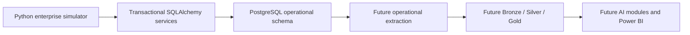
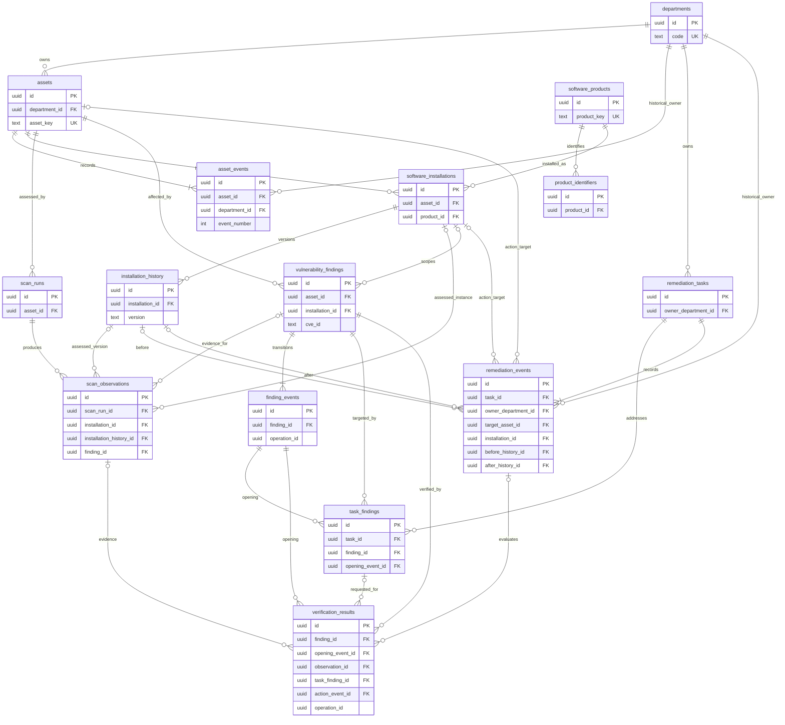

# Operational database architecture

Status: Milestones 1–4 are implemented. Revisions `0001`–`0004` now create all
15 approved operational tables: seven inventory, four assessment/finding and
four remediation/verification tables. The first 11 table definitions and previous
revisions are unchanged by Milestone 4.

## Scope and boundaries



There is no operational FastAPI application. Services accept a SQLAlchemy session
and domain inputs and raise Python exceptions. No HTTP schemas, routers,
authentication, pagination, dependency injection, or operational web interface are
needed. FastAPI dependencies are available through the optional `api` extra for
possible future analytical functionality. There is no schema dependency on HTTP.

NVD, EPSS, KEV, ingestion, warehouse transformations, simulation, and AI are future
work. Alembic owns operational DDL, not analytical transformations. AI can run as
Python modules without an API.

## Retained baseline

All domain primary keys are UUIDs. All business timestamps are timezone-aware.
Current state uses `created_at`/`updated_at`; historical records distinguish
`occurred_at` (business/simulated time) from `recorded_at` (actual insertion time).
Required fields use NOT NULL. Use named checks, foreign keys with RESTRICT
deletion, text statuses with checks, and indexes for operational access paths.
Retire entities instead of cascading away their history. Small JSONB evidence
objects are allowed; business relationships are relational.

| Table | Purpose and principal constraints |
| --- | --- |
| `departments` | Stable department ID, unique nonrecycled code, current name, retirement time. |
| `assets` | Unique immutable asset key; hostname, department FK, owner reference, type/environment, criticality 1–5, exposure, lifecycle and registration/retirement times. Index department/status. |
| `asset_events` | Append-only typed snapshots of asset attributes including department FK and criticality; unique `(asset_id, event_number)`; business and insertion times. Registration creates the initial snapshot. |
| `software_products` | Unique product key, name, publisher text and ecosystem; product names are not matching keys. No separate vendor or release catalog. |
| `product_identifiers` | Product FK, scheme and identifier; unique `(product_id, scheme, identifier)`; lookup index on scheme/identifier. Identifiers are candidate associations, not vulnerability proof. |
| `software_installations` | Stable installation identity, asset/product FKs, context key; unique `(asset_id, installation_key)`. Remains stable across upgrades of the same logical installation. |
| `installation_history` | Installation FK, exact version and qualifiers, start/end times, timestamp basis, end reason and recording times. At most one open period per installation; positive-duration closed periods. |
| `scan_runs` | One asset per run; source, producer version, external run key, optional batch key, synthetic flag, scope, status and times. Unique `(source_key, external_run_key, asset_id)`. |
| `scan_observations` | Immutable CVE/test/outcome/evidence, scan FK, optional installation/history/finding FKs; unique `(scan_run_id, external_observation_key)` and payload digest. Scoped history FK ensures version belongs to installation. Positive installation evidence requires the assessed version. |
| `vulnerability_findings` | Stable asset/optional-installation/CVE identity; `open` or `resolved`, first/last positive observation, current opening/resolution times and SLA. Unique `(asset_id, installation_id, cve_id) NULLS NOT DISTINCT`; scoped installation/asset FK. |
| `finding_events` | Append-only opened/resolved/reopened/SLA-change transitions with resulting status and SLA snapshot; unique `(finding_id, event_number)` and `(finding_id, operation_id)`. An opening event identifies an occurrence. |
| `remediation_tasks` | Unique task key, owner department FK, assignee reference, goal (eliminate/mitigate), priority, due date, estimate, current status and timestamps. |
| `task_findings` | Task/finding FKs and scoped opening-event FK; unique `(task_id, finding_id, opening_event_id)`. Withdrawal retains reason/time. Old-cycle work cannot silently target a recurrence. |
| `remediation_events` | Typed append-only task snapshots and action-result events, assignment/status/deadline changes, actor, times, target and before/after installation-history FKs. Unique task event number/key and action attempt key. One action attempt targets one asset/installation and may address several CVEs. |
| `verification_results` | Immutable evidence decisions with finding/opening-event FKs, optional observation/task-link/action-event FKs, method/verdict, evidence and decision times, verifier, operation ID and digest. Unique `(finding_id, operation_id)`; at most one accepted absence per opening event. |

Use candidate keys such as `(id, asset_id)` and `(id, finding_id)` for scoped
foreign keys. The service also checks matching CVE, asset and action scope. CVEs
remain strings matching `^CVE-[0-9]{4}-[0-9]{4,}$`, without intelligence-table FKs.
Actor/assignee references are stable namespaced strings, not a local identity
directory. Ordinary mutations and historical inserts commit together.

## ERD



## Implemented assessment and finding contract (Milestone 3)

The inventory implementation agrees with the approved baseline: installation IDs
remain stable across version changes, and the candidate keys `(id, asset_id)` on
installations and `(id, installation_id)` on history already exist. No inventory
model or previous migration changes are needed. The old implementation-plan stop
at Milestone 2 is superseded by this increment. Milestone 3 reached 11 operational tables; Milestone 4 completes the same
15-table design below.

`ScanRun` represents one asset execution. Its source-scoped identity is
`(source_key, external_run_key, asset_id)`; a batch key groups executions without
adding a batch table. `producer_version`, explicit `is_synthetic`, and a bounded
JSONB scope object retain producer and declared coverage. Scope describes the
producer's assessment, not independently validated completeness. All scopes and
evidence objects are capped at 16 KiB of JSON text in PostgreSQL. No scan status
or scope claim authorizes automatic resolution in Milestone 3.

Runs can be created queued, running, or already terminal for batch ingestion.
`set_scan_status` permits queued -> running/cancelled and running ->
completed/partial/failed/cancelled. Terminal states are final; a new attempt uses
a new run key. A queued cancellation may have no start. Other finished execution
states require both times, and completion cannot precede existing observations.
Creation retry compares a SHA-256 digest of normalized creation inputs, even if
execution status has subsequently advanced. Changed content raises
`IdempotencyConflictError`; a digest is an integrity/idempotency aid, not a signed
security assertion.

`ScanObservation` is immutable evidence. Its source key is scoped through its
run: `(scan_run_id, external_observation_key)`. The same external observation key
in another execution represents another observation. SHA-256 covers normalized
content, UTC business time, actor and requested opening SLA; identical retry
returns the original row, and changed content conflicts. Recording time and
server-generated IDs are excluded. Scope/evidence dictionary key order does not
affect retries. Source/producer/synthetic provenance comes from the run; rule/test
identity is retained on each observation.

A controlled redundant `scan_observations.asset_id` allows composite foreign keys
to enforce scan/installation/asset agreement without triggers or extra tables.
Composite keys also enforce history-to-installation and finding-to-asset/CVE
agreement. Nullable scope equality between an observation and its optional
finding is additionally enforced by reconciliation: PostgreSQL's ordinary
composite FK semantics skip checks containing nulls. Arbitrary SQL must follow
this writer contract. CVEs are syntax-checked strings without intelligence FKs.
No product name, CPE, version, or valid-looking CVE is treated as applicability
proof.

An affected installation observation requires the precise historical version
present at evidence time. Half-open inventory periods apply: evidence at the end
belongs to the next period, if any. Explicit target absence can optionally
reference an already-ended version; other evidence with a version reference must
fall inside its period. Evidence must lie within scan execution and the asset's
registered lifetime. Positive evidence from partial/failed runs is accepted;
negative, inconclusive and omitted observations never resolve findings.

`record_observation` inserts evidence and reconciles affected outcomes in the
caller's transaction. `(asset_id, installation_id, cve_id) NULLS NOT DISTINCT`
identifies one persistent finding across its entire lifecycle, including genuinely
asset-scoped findings. First detection inserts an `opened` event. Repeats advance
`last_observed_at` using the maximum positive evidence time and preserve the
original opening and SLA. Negative evidence links to an existing matching finding
when present, without creating one. Opening event operation IDs equal their
causing observation IDs; they are correlation IDs without a reverse FK cycle.

A resolved finding reopens only for positive evidence strictly after resolution
and its latest lifecycle event. Reopening retains `first_detected_at`, creates a
new numbered `reopened` event, changes `current_opened_at`, clears the current
resolution time, and snapshots the supplied versioned `SLAPolicy`. The deadline
is opening time plus target seconds. A null policy explicitly means no configured
SLA for the new occurrence. Repeats never reset it. Old event snapshots remain
intact. `resolved` events are now written by Milestone 4 verification. `sla_changed`
remains reserved: there is no SLA-edit command. The assessment ingestion service
itself never resolves a finding.

Late positive evidence inside an already-known open interval is preserved and
associated with that finding without creating a recurrence. If the finding is
still resolved, its last-positive time may advance within that interval, strictly
before resolution. Evidence before the first opening, exactly at resolution, or
inside a previously closed gap before an established reopening is rejected with
`HistoricalConflictError`. Such evidence may invalidate a historical decision or
require an earlier opening: manual reconciliation is needed. Milestone 3 does not
silently rewrite history or keep a separate episode table.

Concurrency uses a run-row lock for observation-key retries/status changes, an
asset share lock when validating the asset lifetime and historical software, then
PostgreSQL's unique insertion and a finding row lock for lifecycle changes.
Inventory writers already lock the asset exclusively before the installation.
Version closure and retirement reject backdating at or before evidence that
would thereby fall outside its assessed period or registered asset lifetime.
The shared asset lock keeps these checks safe against in-flight observations;
assessment readers of the same asset remain concurrent. First
detections on different runs serialize through the finding unique key, including
the null-installation case. Unrelated assets/findings are not globally locked.
Future verification must use a compatible lock order (scan when needed,
asset, installation when changing it, finding); it must not hold a finding while waiting for inventory
locks. Multi-finding batches should process stable sorted identities to avoid
opposite-order deadlocks and retry whole transactions on PostgreSQL deadlocks.

Services flush but never commit. A rejected operation must roll back its
caller-owned transaction, including its scan if created in that transaction.
Observations and finding events have ORM append-only guards, consistent with
inventory; Core/bulk SQL bypasses them. Database constraints enforce required
references, scoped uniqueness, supported status/outcome/CVE values, bounded JSON,
SLA completeness and local timestamp order. Chronology across rows, valid
transitions and matching current-state/event histories require service use.
Indexes support run/asset timelines, run status and batches, finding CVE/status/
deadline lookups, evidence by finding/time, historical targets and recorded-time
extraction. UUIDs, recording times and business times remain distinct; insertion
sequence alone is not a commit-order ETL checkpoint.

See [assessment service examples](assessment-services.md). The original
Milestone 3 recurrence tests retain labelled resolved-state fixtures; Milestone 4
adds end-to-end tests using the implemented verification service.

## Verification correction and transaction contract

The one necessary baseline correction is to **remove
`verification_results.resolution_event_id`**. The accepted decision and its
resolution event instead carry the same `operation_id`. The existing
verification-to-opening-event FK remains. Do not add a reverse
finding-event-to-verification FK: that would create a dependency cycle, directly
or through task links. There are no current-state verification pointers.

The operation ID correlates two records; it is deliberately not a cross-table FK.
Uniqueness rejects duplicate records on each side. A transactional service and
integration tests enforce that an accepted absence decision has exactly one
matching resolution event, with the same finding and business time. This is an
explicit service-level guarantee, not a claim that arbitrary SQL enforces the
entire workflow.

One command owns one transaction:

1. Lock an associated task if present, then the evidence scan, asset and finding
   in the established writer order. Identify the current opening event. Validate the
   operation key/digest; return the previous result on an identical retry and
   reject a conflicting retry.
2. Validate evidence: target/CVE/occurrence agree, the asset scan completed, the
   relevant assessment completed, and evidence is newer than the latest positive
   observation and applicable action. No later inventory change may invalidate
   the evidence. `target_absent` requires explicit complete inventory evidence.
3. Insert the verification decision first. Failure/inconclusive/mitigation
   decisions preserve the finding's open status. A manual decision requires
   reviewable evidence and an explicitly identified verifier.
4. For accepted absence only, update the finding to resolved and append a
   `resolved` event with the same operation ID. `resolved_at` is the supported
   evidence time; `verified_at` is when the decision was made in business time.
5. Commit all changes together. Any exception rolls back the decision, current
   state and event. Do not commit between service calls.

Task completion is not resolution. An eliminate task closes only when all active
target occurrences have accepted absence decisions. A mitigate task may close
with currently valid mitigation evidence while the findings remain open.
Expired evidence cannot establish current mitigation effectiveness.

Repeated positive observations update the same finding. A positive observation
after resolution reopens it with a new opening event. Old task links and decisions
remain bound to their old opening event. Missing observations, failed/partial
scans, asset retirement and inventory removal do not imply resolution.

Services use focused functions/classes, never a generic repository framework.
They accept a session, timezone-aware business timestamps, stable operation IDs,
provenance and domain inputs; they may flush but must not independently commit.
The runner/application command opens `session_factory.begin()` and calls the
needed services. Nested calls share that session. Domain exceptions will include
invalid transitions, invalid evidence, conflicting idempotency keys and invalid
inventory periods. Inventory exceptions now exist; evidence and remediation
exceptions belong to later milestones. No HTTP adapter is needed.

## Implemented remediation and verification (Milestone 4)

Revision `0004` depends on `0003` and adds exactly the four remaining tables.
No first-11-table redesign or historical migration edit is needed. The previous
finding-first wording of the verification transaction was inconsistent with the
implemented assessment lock order; parent scan/asset locks are acquired first.
The shared verification/resolution operation ID contract is retained unchanged.

### Tables and integrity

- `remediation_tasks`: UUID identity, nonrecycled unique `task_key`, title,
  description, owner department, optional assignee, priority 1–5, immutable goal
  (`eliminate`/`mitigate`), timezone-aware due/start/work-completed/closed times,
  nonnegative integer estimated effort in minutes, current status and database
  creation/update times. Checks enforce local timestamp/state consistency;
  indexes cover owner/status, status/due and assignee.
- `task_findings`: UUID link identity, task/finding FKs and scoped
  `(opening_event_id, finding_id)` FK, added business/recording times and actor.
  Unique `(task_id, finding_id, opening_event_id)` includes withdrawn links.
  Withdrawal is a one-time closure with reason, actor, business and recording
  time. A historical withdrawn link is not reactivated; use another task for the
  same occurrence, or a new opening event for a recurrence. The service checks
  that the referenced event is actually an opening/reopening, not only an event
  belonging to the finding. Index finding/opening for reverse lookup.
- `remediation_events`: UUID identity; unique task event number and
  `(task_id, operation_id)`; SHA-256 request digest; typed full resulting task
  snapshot, reason, actor/source/synthetic flag, business and recording times.
  Action fields retain asset/installation, kind, outcome, nonnegative actual
  effort in minutes, evidence reference and bounded JSONB, and scoped before/
  after version FKs. Scope events reference their task link. Checks distinguish
  action from state events. Timeline, action-target/time, version-reference and
  recording-time indexes support operational queries and extraction.
- `verification_results`: UUID decision identity, finding/scoped opening FK,
  optional scoped task-link FK, observation/action/history FKs, method, verdict,
  accepted flag, evidence and decision business times, recording time, verifier,
  rationale, source/actor/synthetic provenance, evidence reference/bounded JSON,
  optional mitigation expiry, operation ID and digest. Unique
  `(finding_id, operation_id)` rejects duplicate logical requests; a partial
  unique index permits at most one accepted absence per opening. Checks enforce
  method/evidence shape, accepted/verdict agreement, decision-after-evidence and
  mitigation validity. Index occurrence/decision time, history/evidence time,
  optional evidence links and recording time.

Every new FK uses RESTRICT; no history cascades away. JSONB evidence retains the
16 KiB object limit. Important fields and state snapshots are relational, not
JSON state blobs. Current state is not an event-sourced reconstruction.

### Work and actions

The task transition service permits:

| Current state | Allowed next states |
| --- | --- |
| `open` | `in_progress`, `cancelled` |
| `in_progress` | `blocked`, `completed`, `cancelled` |
| `blocked` | `in_progress`, `cancelled` |
| `completed` | `in_progress`, `closed`, `cancelled` |
| `closed` / `cancelled` | `open` with an explicit reopening reason |

Empty tasks can be planned but cannot start work, complete or close successfully.
Starting work requires current open target occurrences. Work completion records
`work_completed_at`; it neither resolves findings nor closes the task.
`closed_at` exists only in the closed state. Reopening clears completion/closure
and retains the first start time; events retain each cycle's business timestamps.
Closed/cancelled scope, ownership and planning cannot change until reopening.
Every mutation validates chronological order and writes a typed event atomically.
Planning deadlines do not change finding SLA snapshots.

`record_action` records a result after work has happened, with no external process
inside its transaction. Kinds are patch, upgrade, downgrade, removal,
configuration and mitigation; outcomes are succeeded, failed or inconclusive.
Only in-progress/blocked tasks may record actions, and the target must match a
current active task occurrence. One action may cover several CVEs on that same
asset/installation; it never resolves any of them by itself.
`apply_software_change` atomically uses the existing inventory services and records
a successful patch/upgrade/downgrade/removal. Software success requires genuine
adjacent before/after periods (or an explicitly closed removal). Failed attempts
remain events; they do not imply a version change. A failure in a surrounding
workflow rolls back both version history and event. These services model recorded
operations; they do not deploy patches or run scanners.

### Evidence and decisions

`verify_finding` always addresses a current open occurrence. A replay returns the
original immutable decision even after resolution. Changed content under the same
operation key raises `IdempotencyConflictError`. Evidence, occurrence, action,
asset, installation and CVE scope must agree. An action must precede its verifying
evidence. Decision time cannot predate evidence or existing decision history.

Scan verification requires a completed run and an explicit observation. Accepted
absence requires `not_affected` or `target_absent`, strictly newer than every
positive observation. Installation `not_affected` must identify the exact version
present at evidence time. `target_absent` additionally requires actual historical
inventory absence and this producer-declared scope structure:

```json
{"inventory_coverage": {"complete": true, "installation_ids": ["installation UUID"]}}
```

The scoped IDs must be a list. This is a trusted producer's coverage assertion,
not independently validated scanner completeness. Scan verification rejects
unfinished/partial/failed runs; their observations still remain available in the
assessment subsystem. An absent observation is never verification evidence.
Scan control verification requires an explicit evidence `control_verdict` of
`effective` or `failed`; vulnerability presence alone says nothing about control
effectiveness. Effective control evidence can coexist with an affected finding.

Manual verification requires an explicitly identified verifier, rationale,
reviewable reference or nonempty bounded evidence, evidence time, and independent
assessment/inventory-review/control-validation category. A patch report by itself
is not an accepted manual evidence category. Exact assessed history is required
when the installation is present. These are documented human attestations,
clearly distinguished from scanner observations; this system does not validate
identity ownership, fetch referenced documents or independently prove the claims.

Accepted decisions also reject intervening inventory changes/actions and newer
contradictory verification results. Decision verdicts are `absence_confirmed`,
`still_affected`, `mitigation_effective`, `mitigation_failed` and `inconclusive`.
Only absence and effective mitigation are accepted; mitigation requires a future
`valid_until`. Failure/inconclusive records preserve open findings.
An accepted absence inserts its decision first, appends a `resolved` event with
the same operation ID and evidence timestamp, and updates finding state in one
transaction. `verified_at` retains the business decision time separately.
Mitigation leaves the finding open. There is no reverse verification FK or
current-state verification pointer. Tests exercise rollback after resolution
flush so neither half of the shared operation can survive independently.

### Closure and concurrency

Only completed tasks may close. Every active occurrence is locked and validated
before any task state change. Eliminate requires accepted absence and matching
current resolution. Mitigate accepts absence or the latest accepted effective
mitigation, valid strictly beyond closure time. New contradictory decisions,
newer positives, inventory changes, later actions or expired validity require
reassessment. Zero active targets and obsolete opening events prevent closure.
An old closed task is a historical success for its old occurrence; recurrence
does not silently retarget/reopen it. Create new work or explicitly reopen and
replace its scope. Expiry is evaluated at closure; there is no background monitor
that later changes closed task state.

Writers acquire task locks before scope/state checks. Where needed, they then
lock scan, asset, installation (for software mutation) and finding. Closure locks
assets and findings in sorted identity order. Scan verification/closure use shared
asset locks; inventory actions use the existing exclusive asset/installation
locks. Positive ingestion and verification serialize on the finding. A competing
newer positive blocks resolution, or becomes a genuine recurrence if resolution
commits first. Late evidence inside a known former open period does not reopen.
Transactions do not span external work. Multi-asset callers must preserve sorted
lock order and retry the entire transaction after PostgreSQL deadlocks.

Existing inventory services additionally reject backdated version closure or
asset retirement that would invalidate manual verification evidence, extending
the same guard already present for observations. No inventory table changes are
needed. Reinstallation cannot backdate a new period into accepted target-absence
evidence. ORM append-only guards cover events/decisions and one-time target
withdrawal; bulk/Core SQL can bypass them. FKs enforce membership, while opening
event type, nullable target scope, cross-row chronology, evidence sufficiency and
verification/resolution pairing remain explicit service guarantees.

See [remediation workflow and runnable fixture](remediation-services.md).

## Installation-period enforcement

Keep half-open intervals `[started_at, ended_at)`, with null end meaning current.
The database checks positive duration and permits only one open period. An
upgrade/downgrade/removal service locks the stable installation row with
`SELECT FOR UPDATE` **before reading its periods**, validates the proposed
timeline, and atomically closes/inserts periods. All writers lock the same parent.

Use the caller's expected current history ID to reject stale competing upgrades.
Milestone 2 rejects unsupported backdated changes, including insertions into
earlier gaps. Reinstallation can append after the latest removal; it cannot
rewrite an earlier interval. Version changes inspect other periods for conflicting
history, including closed periods. Adjacency is allowed; zero-length periods are
not. Version strings are opaque: the caller explicitly declares upgrade/downgrade.

No exclusion constraint or extension is used initially. This only guarantees
nonoverlap when all writers follow the locking/validation contract. Raw SQL,
bulk imports bypassing services, or code locking a different row can insert
overlapping **closed** periods despite the ordinary constraints. Administrative
corrections need explicit review and the same timeline validation. Reconsider an
exclusion constraint if independent writers are introduced.

Milestone 2 tests cover concurrent upgrades on separate connections (including an
observed PostgreSQL lock wait), stale expected-version rejection, adjacent periods,
removal/reinstallation, rejection of earlier-gap insertion and backdated overlaps,
duplicate current periods, and complete rollback after an injected failure.

Inventory services lock the asset before its installation; this also serializes
software writes against asset retirement. Asset retirement requires explicit
software removal first, never fabricated removal timestamps. Departments cannot
retire while owning nonretired assets, or before the recorded timelines of assets
previously assigned to them. This is a conservative backdating policy.

Asset changes write complete snapshots and reject timestamps before the latest
event. Equal event times use event numbers for order. No-op updates write no event.
Department assignments and criticality are retained; department names are not.
ORM flush guards reject identity changes, asset-event edits/deletes and version
history rewrites; a version period may be closed once. These are convenience
guardrails, not database triggers or a replacement for service use. Core/bulk SQL
can bypass them. No role/permission enforcement framework is introduced here.

`EventContext` explicitly supplies UTC-normalized business time, actor, source and
synthetic provenance. Creation/update/recording timestamps use the actual database
clock. Installation closures retain separate recording time and end provenance.
See [inventory service examples](inventory-services.md) for implemented calls.

## History and analytical limits

Asset snapshots preserve department **assignments**, ownership, criticality,
exposure and lifecycle at each event. They reference stable department IDs.
Department-name history is not retained: a future DimAsset SCD Type 2 can reflect
historical assignments and criticality, but historical department labels cannot
be reconstructed after a rename. DimDepartment initially has current labels.
Product-description history is similarly outside the initial scope.

Finding opening/resolution/reopening events retain known exposure intervals,
recurrence and SLA snapshots; task events retain deadline/status changes and
attempt outcomes. SLA extensions are explicit events and do not erase original
deadlines. Task reassignment does not reset detection-based SLAs.

Scans are point observations, not continuous measurements. First-observed software
times are not necessarily installation times. A patch followed by resolution is
an association, not causal proof. Late source evidence retains its source time;
it must not silently create a false recurrence or rewrite past transitions.
Retrospective corrections require an explicit procedure. This is not full event
sourcing or a complete bitemporal model.

Future extraction uses stable IDs, consistent snapshots, both kinds of timestamps
and reconciliation. A maximum insertion timestamp/allocated sequence alone is not
a reliable commit-order checkpoint. No ETL or warehouse objects exist yet.

## Future simulator contract

The simulator will generate departments, hundreds of assets, inventories, repeated
assessments, remediation tasks, failed/successful patch attempts and verification
over a configurable timeline, such as 30–90 simulated days. All writes use the
same services as integration tests. No arbitrary simulator table writes.

Configuration will include scenario ID/version, seed, enterprise size and an
explicit timezone-aware date range. A stable ordered event schedule, deterministic
random generator, operation IDs derived from scenario/event identity, and stable
fixture inputs make logical results reproducible. Replaying the same scenario
namespace is idempotent; a new experiment uses a new namespace. Recording times
will differ across independent executions even when business events are identical.
Never use wall-clock defaults for simulated business events. Both simulated
decision time and actual insertion time are retained.

Until validated NVD CPE/version applicability exists, use explicitly labelled,
versioned fixture associations for integration/end-to-end scenarios. Never infer
software applicability by randomly assigning real CVEs. Fixture provenance and
synthetic event flags distinguish operational simulation from real NVD/EPSS/KEV
source data. No matching engine or external ingestion is implemented here.

The eventual documented interface is planned as
`uv run python -m patchledger.simulation.runner --scenario ... --seed ... --start ... --end ... --assets ...`.
It does not exist in Milestone 1. Only introduce simulator modules when their
functionality is implemented.

## References

- [SQLAlchemy session transaction boundaries](https://docs.sqlalchemy.org/en/20/orm/session_basics.html#framing-out-a-begin-commit-rollback-block)
- [Alembic autogeneration and schema filtering](https://alembic.sqlalchemy.org/en/latest/autogenerate.html#controlling-what-to-be-autogenerated)
